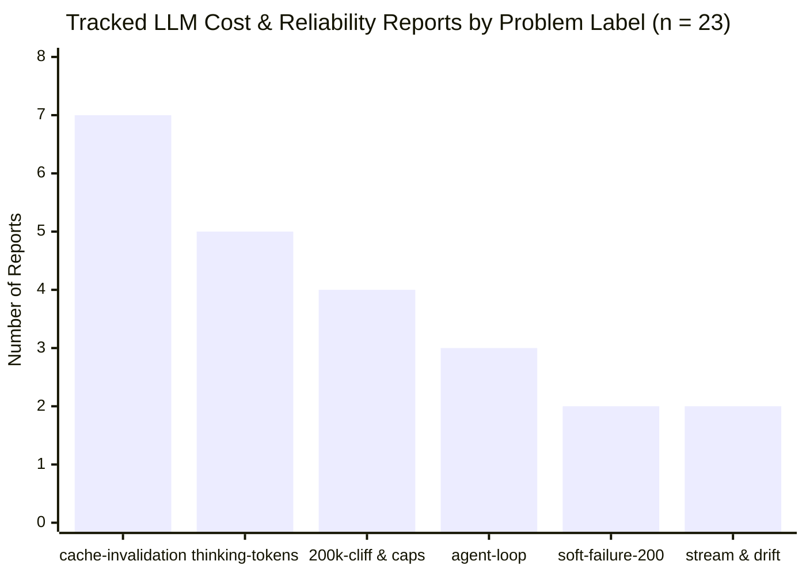
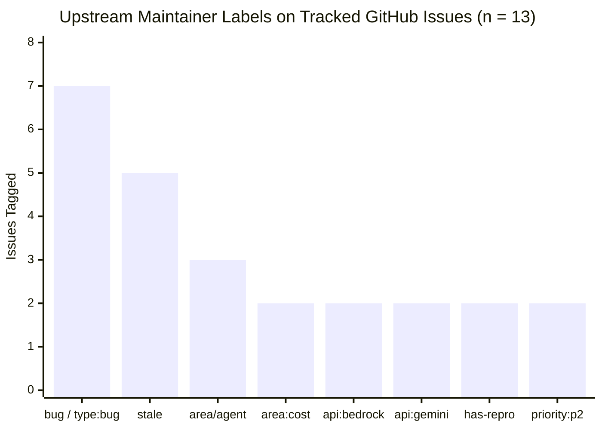
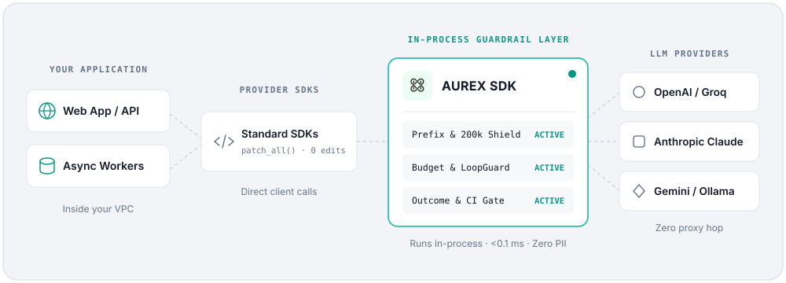

<p align="left">
  <picture>
    <source media="(prefers-color-scheme: dark)" srcset="./assets/logo-white.png">
    <source media="(prefers-color-scheme: light)" srcset="./assets/logo-dark.png">
    
  </picture>
</p>

# Aurex SDK — Plain-English Guide & Problem Evidence

[](https://pypi.org/project/aurex-sdk/)
[](https://pypi.org/project/aurex-sdk/)
[](../sdk/node)
[](../README.md)

`aurex-sdk` is an open-source, in-process **Python** (`pip install aurex-sdk`) and **Node.js / TypeScript** (`npm install aurex-sdk`) FinOps shield, runtime circuit breaker, and CI outcome gate for LLM applications. It runs inside your own process with **`<0.1 ms` overhead**, **zero proxy network hops**, and **zero raw prompts leaving your servers**.

> Using an AI coding agent (Claude Code, Cursor, Antigravity, Codex, Copilot)? Point it to [`../llms.txt`](../llms.txt) or [`../AGENTS.md`](../AGENTS.md) for instant drop-in integration.

## 1. What Problems Are Teams Facing? (23 Real GitHub & Reddit Reports)

Most teams only discover LLM cost spikes on next month's cloud invoice. Across **13 frontier-lab GitHub issues** (`anthropics/claude-code`, `googleapis/python-genai`, `google-gemini/gemini-cli`, `openai/codex`, `openai/openai-python`, `openai/openai-agents-python`, `vllm-project/vllm`) and **10 engineering Reddit threads**, six concrete failure modes account for the majority of unexpected spend:

### Graph 1: Number of Tracked Reports per Problem Label (`n = 23`)



### Graph 2: Upstream GitHub Maintainer Labels Across the 13 Frontier-Lab Issues



### Complete Problem Evidence Links (GitHub Issues & Reddit Threads)

| Source & Exact Link | Problem Reported by Developers | Problem Label | Aurex Stage |
| :--- | :--- | :--- | :--- |
| [anthropics/claude-code#91151](https://github.com/anthropics/claude-code/issues/91151) | `200k` long-session prompt cache collapses back to baseline on resume, triggering massive `cache_creation` rewrite bills (`bug`, `area:cost`, `api:bedrock`, `has repro`). | `cache-invalidation` | **Stage 1** |
| [anthropics/claude-code#60830](https://github.com/anthropics/claude-code/issues/60830) | Prompt-cache writes `<2%` above `150k` context on Bedrock vs. 1P Anthropic API (`bug`, `area:cost`, `api:bedrock`). | `cache-invalidation` | **Stage 1** |
| [anthropics/claude-code#42796](https://github.com/anthropics/claude-code/issues/42796) | Extended thinking spikes and sub-agent fan-out rapidly drain session budgets (`bug`, `area:model`). | `thinking-tokens` | **Stage 2** |
| [googleapis/python-genai#782](https://github.com/googleapis/python-genai/issues/782) | `thoughts_token_count` consumes `max_output_tokens` and returns empty visible text while billing full output rates (`type: bug`, `priority: p2`, `api: gemini-api`). | `thinking-tokens` | **Stage 2 & 3** |
| [googleapis/python-genai#1795](https://github.com/googleapis/python-genai/issues/1795) | `thought_token` count unexpectedly exceeds configured thinking budget (`type: bug`, `priority: p2`). | `thinking-tokens` | **Stage 2** |
| [googleapis/python-genai#2062](https://github.com/googleapis/python-genai/issues/2062) | `max_output_tokens` caps thinking + output combined, causing truncated/empty paid responses (`type: bug`, `api: gemini-api`). | `soft-failure-200` | **Stage 3** |
| [google-gemini/gemini-cli#16448](https://github.com/google-gemini/gemini-cli/issues/16448) | Autonomous CLI agent enters a repetitive thinking loop (`area/agent`). | `agent-loop` | **Stage 2** |
| [google-gemini/gemini-cli#16160](https://github.com/google-gemini/gemini-cli/issues/16160) | Agent enters an infinite text loop during multi-step problem solving (`area/agent`). | `agent-loop` | **Stage 2** |
| [openai/codex#60294](https://github.com/openai/codex/issues/60294) | Agent hangs when an OpenAI-compatible model returns `HTTP 200` with whitespace-only (`"\n"`) content (`bug`). | `soft-failure-200` | **Stage 3** |
| [openai/openai-python#3480](https://github.com/openai/openai-python/issues/3480) | Upstream `v2.45.0` `InputTokensDetails` (`cache_write_tokens`) breaking change crashes downstream agent SDKs. | `stream & drift` | **Drift Guard** |
| [openai/openai-agents-python#462](https://github.com/openai/openai-agents-python/issues/462) | Accessing and accounting for `reasoning_tokens` across reasoning models. | `thinking-tokens` | **Stage 2** |
| [openai/openai-agents-python#442](https://github.com/openai/openai-agents-python/issues/442) | Streaming fails or omits usage when passing `stream_options={"include_usage": True}` (`feature:chat-completions`). | `stream & drift` | **Stage 2** |
| [vllm-project/vllm#44824](https://github.com/vllm-project/vllm/issues/44824) | OpenAI-compatible serving endpoint leaves `prompt_tokens_details.cached_tokens` unpopulated at `0`. | `cache-invalidation` | **Stage 1 & 2** |
| [r/ClaudeAI · `1xksgor`](https://www.reddit.com/r/ClaudeAI/comments/1xksgor/things_that_quietly_break_your_prompt_cache_in/) | How `5m` idle gaps, mid-session model switches, and dynamic prompt edits silently wipe out 90% cache discounts. | `cache-invalidation` | **Stage 1** |
| [r/ClaudeAI · `1s7mkn3`](https://www.reddit.com/r/ClaudeAI/comments/1s7mkn3/psa_claude_code_has_two_cache_bugs_that_can/) | Pre-wire payload mutations breaking exact prefix matching and multiplying bills `10x–20x`. | `cache-invalidation` | **Stage 1** |
| [r/OpenAI · `1uszfrr`](https://www.reddit.com/r/OpenAI/comments/1uszfrr/gpt56_prompt_caching_appears_completely_broken/) | Unexpected `cached_tokens = 0` misses on repeated OpenAI requests. | `cache-invalidation` | **Stage 1** |
| [r/openrouter · `1uf3ij4`](https://www.reddit.com/r/openrouter/comments/1uf3ij4/is_anyone_else_paying_1032x_more_on_openrouter/) | Multi-provider routing breaking KV caches and inflating agent bills `10x–32x`. | `cache-invalidation` | **Stage 1 & 3** |
| [r/ClaudeAI · `1p05r7p`](https://www.reddit.com/r/ClaudeAI/comments/1p05r7p/my_claude_code_context_window_strategy_200k_is/) | Why crossing `200k` tokens triggers a 2x whole-request surcharge and hurts recall. | `200k-cliff & caps` | **Stage 1** |
| [r/googlecloud · `1jz43y6`](https://www.reddit.com/r/googlecloud/comments/1jz43y6/056_to_34315_in_minutes_google_gemini_api_just/) | `\$0.56` to `\$34,315` Gemini API bill in minutes due to missing real-time spend cutoffs. | `200k-cliff & caps` | **Stage 2** |
| [r/googlecloud · `1szv8cr`](https://www.reddit.com/r/googlecloud/comments/1szv8cr/warning_google_cloudgemini_api_spend_caps_do_not/) | Why GCP/Gemini budget alerts notify hours late instead of blocking runaway live calls. | `200k-cliff & caps` | **Stage 2** |
| [r/googlecloud · `1vmxjry`](https://www.reddit.com/r/googlecloud/comments/1vmxjry/long_term_feasibility_of_using_gemini_due_to/) | Unit-economics breakdown of Gemini's `>200k` 2x tiered pricing cliff. | `200k-cliff & caps` | **Stage 1** |
| [r/ClaudeCode · `1vca1ma`](https://www.reddit.com/r/ClaudeCode/comments/1vca1ma/claude_code_burned_my_entire_fivehour_limit_in_6/) | Stuck autonomous tool-retry loop burning an entire 5-hour quota in 6 minutes. | `agent-loop` | **Stage 2** |
| [r/Bard · `1p113qb`](https://www.reddit.com/r/Bard/comments/1p113qb/api_calls_to_gemini_3_about_40_more_expensive/) | Hidden internal thinking tokens billed at output rates making routine calls ~40%+ costlier. | `thinking-tokens` | **Stage 2 & 3** |

## 2. What Does Aurex Solve? (The 3-Stage Pipeline)

<p align="center">
  <picture>
    <source media="(prefers-color-scheme: dark)" srcset="./assets/architecture-dark.svg">
    <source media="(prefers-color-scheme: light)" srcset="./assets/architecture-light.svg">
    
  </picture>
</p>

1. **Before the Call (Stage 1 — Prefix & `200k` Cliff Shield):** Sorts JSON keys deterministically in `tools` and schemas so unstable dict ordering stops breaking caches, pinpoints the exact character index that mutated on a cache miss, warns on `>5 min` Anthropic idle TTL gaps (`1.25x` rewrite penalty), and warns before crossing `200,000` input tokens (`2x` whole-request repricing). Runtime hints append at the **tail** of messages so index `0` caches never break.
2. **During the Call (Stage 2 — Spend, Thinking & Stream Circuit Breaker):** Isolates sessions automatically (`workflow_id` -> async context -> active OpenTelemetry `trace_id`), enforces live per-session and per-minute USD caps across multi-worker pods via optional Redis, clamps `max_thinking_tokens`, injects `stream_options.include_usage`, records partial spend on aborted streams in `try...finally`, suppresses `6x` double-retry storms (`max_retries=0`), and raises `AurexBlocked` when an agent loops.
3. **After the Call + CI (Stage 3 — Verified Outcome Cost & PR Gate):** Flags empty thinking-exhausted outputs and `\n\n\n` JSON grammar loops as `unfulfilled_spend`, pairs spend with `mark_success(workflow_id)` to measure real **cost per completed task**, enforces per-tenant margin downgrades, and posts cost regression diffs on Pull Requests via `aurex ci`.

## 3. How to Use It (Step-by-Step)

### Step 1: Install

```bash
# Python
pip install aurex-sdk
# Optional Redis + OpenTelemetry extras:
pip install "aurex-sdk[redis,otel]"

# Node.js / TypeScript
npm install aurex-sdk
```

### Step 2: Initialize Once at App Startup

**Python**
```python
from aurex_sdk import AurexAuditor, AurexBlocked, AurexConfig, patch_all
import openai

auditor = AurexAuditor(
    AurexConfig(
        enable_loop_guard=True,
        budget_guard={
            "max_cost_per_session": 1.50,
            "max_cost_per_minute": 15.00,
            "max_context_tokens": 195000,
            "max_thinking_tokens": 4096,
            "on_budget_exceeded": "throw",
        },
        resilience={"enabled": True, "mode": "enforce", "max_attempts": 2},
    )
)
patch_all(auditor)

client = openai.OpenAI()
resp = client.chat.completions.create(
    model="gpt-4o",
    messages=[{"role": "user", "content": "Summarize support ticket #42."}],
    workflow_id="ticket-42",
    tags={"tenant_id": "acme-corp"},
)

auditor.mark_success("ticket-42")
auditor.flush()
```

**Node.js / TypeScript**
```typescript
import { AurexAuditor } from "aurex-sdk";
import OpenAI from "openai";

const auditor = AurexAuditor.getInstance({
  enableLoopGuard: true,
  budgetGuard: {
    maxCostPerSession: 1.5,
    maxCostPerMinute: 15.0,
    maxContextTokens: 195000,
    maxThinkingTokens: 4096,
    onBudgetExceeded: "throw",
  },
  resilience: { enabled: true, mode: "enforce", maxAttempts: 2 },
});
await auditor.patchAll();
auditor.instrument(OpenAI); // Explicit hook for Next.js / Vite / Vitest bundlers

const client = new OpenAI();
const resp = await client.chat.completions.create({
  model: "gpt-4o",
  messages: [{ role: "user", content: "Summarize support ticket #42." }],
  workflowId: "ticket-42",
  tags: { tenant_id: "acme-corp" },
} as any);

auditor.markSuccess("ticket-42");
await auditor.flushAndWait();
```

### Step 3: Audit Locally, Gate Pull Requests in CI, or Run Zero-Code Hook

```bash
# Local waste & cache-break summary
aurex audit

# Pull Request CI regression gate
aurex ci --ledger .aurex/ledger.jsonl --baseline main_ledger.jsonl --github-comment --fail-on-regression

# Optional zero-code startup hook
aurex install-hook && AUREX_ENABLED=1 python app.py
```

## 4. Real-World Testing & Open-Source Agent Benchmarks (`8.6 / 10`)

Aurex was evaluated end-to-end across **SWE-agent** (autonomous coding on Google Gemini `gemini-2.5-flash` reasoning models), **LangGraph** multi-agent workflows on local **Ollama** (`granite4.2:3b`, `llama3.1`), and **110+ automated Python, Node.js, and Backend tests**:

### SWE-agent Trajectory Breakdown

Aurex allowed **3 full exploration turns** (`str_replace_editor` path discovery and file inspection) before catching non-progressive structural repetition on **Step 4**, while logging streamed Gemini reasoning tokens and Zero-PII SHA-256 prompt hashes. On real multi-file repository tasks (`40k–120k` context + `4k–16k` reasoning tokens per step), halting a stuck `30–50` step loop at Step 4 prevents **1.5M–5M+ wasted tokens** per runaway run:

| Step | SWE-agent Action | Observation | Aurex Status |
| :--- | :--- | :--- | :--- |
| **Step 1** | `str_replace_editor view .../missing_colon.py` | File not found (wrong directory path) | **Allowed** |
| **Step 2** | `str_replace_editor view .../test-repo` | Listed folder structure to locate file | **Allowed** |
| **Step 3** | `str_replace_editor view .../tests/missing_colon.py` | Read and displayed target source file | **Allowed** |
| **Step 4** | 4th consecutive `str_replace_editor` without a diff | Pattern `['str_replace_editor', 'str_replace_editor', 'str_replace_editor']` | **Blocked (`AurexBlocked`)** |

### Evaluation Scorecard

| Category | Score | Summary |
| :--- | :---: | :--- |
| **1. Code Implementation (DX)** | **9.0 / 10** | One-line `patch_all(auditor)` interception across LiteLLM, OpenAI, Gemini, and Ollama. |
| **2. Guardrails & Governance Features** | **8.8 / 10** | Accurate streaming thought-token tracking, 3-step exploration headroom, and session USD caps. |
| **3. Log & Telemetry Clarity** | **8.5 / 10** | Readable `AurexBlocked` messages and structured `.aurex/ledger.*.jsonl` outcome events. |
| **4. Framework Resilience & Compatibility** | **8.0 / 10** | `<0.1 ms` overhead across local Ollama (`\$0.00`) and cloud endpoints. |
| **Composite Score** | **8.6 / 10** | **Production-ready & verified on real multi-agent loops.** |

## 5. Data Privacy, Setup Improvements & Contributing

- **Zero-PII Local Default:** Without `AUREX_API_KEY`, zero data leaves your machine—metrics and one-way SHA-256 hashes write locally to `.aurex/ledger.jsonl`. Even with opt-in cloud sync enabled, raw prompt and response text are never sent or stored (`prompt=None`, `response=None`).
- **Move dynamic values to prompt tails & cap context at `195,000` tokens:** Preserve 50%–90% prefix-cache discounts and prevent accidental `200k` 2x whole-request repricing on Claude 4+ and Gemini 2.5+.
- **Propagate `workflow_id` & skip retrying `AurexBlocked`:** Use `aurex_context.set({"workflow_id": run_id})` / `aurexContext.run({ workflowId }, ...)` in LangGraph or sub-agent hooks, exclude `AurexBlocked` from `tenacity` (`retry=retry_if_not_exception_type(AurexBlocked)`), and raise `loop_similarity_threshold` (`0.90`–`0.95`) when coding agents need wider file-reading headroom on large benchmarks.
- **Share state across pods & contribute:** Set `AUREX_REDIS_URL=redis://...` in multi-worker deployments. To contribute, fork [bhav09/aurex-sdk](https://github.com/bhav09/aurex-sdk), keep Python and Node.js changes in lockstep, run `AUREX_STRICT_DRIFT=1 bash .agent/skills/aurex-smoke-test/scripts/run_smoke.sh`, and open a Pull Request.
